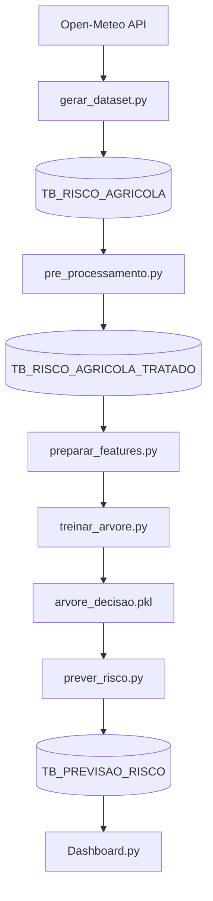

# SompoRisk AI 🤖

## 📌 Enterprise Challenge — Sompo

### Integrantes

* Thiese Novaes — RM572659
* João Vitor — RM572969
* Talles Duran — RM572772
* Kevin Santiago — RM573808
* Renan Souza — RM568958

---

# 🚀 1. Visão Geral

A **SompoRisk AI** é uma solução baseada em **Dados e Inteligência Artificial** para identificar, prever e reduzir riscos operacionais relacionados ao uso de equipamentos agrícolas.

A proposta busca transformar decisões reativas em decisões preventivas, utilizando dados climáticos históricos, indicadores operacionais e Machine Learning para apoiar operadores, gestores e seguradoras.

---

# ⚠️ 2. Problema

Atualmente, muitas operações agrícolas atuam de forma reativa, tomando decisões somente após a ocorrência de falhas, acidentes ou prejuízos operacionais.

Consequências:

* aumento de sinistros;
* perda de equipamentos;
* interrupções operacionais;
* custos de manutenção elevados;
* dificuldade na prevenção de riscos.

O principal desafio é a ausência de mecanismos capazes de correlacionar fatores ambientais e operacionais para antecipar situações críticas.

---

# 💡 3. Solução Proposta

A SompoRisk AI propõe uma plataforma inteligente capaz de:

* monitorar fatores ambientais e operacionais;
* identificar padrões de risco;
* prever cenários críticos;
* emitir alertas preventivos;
* apoiar decisões operacionais.

### Principais Saídas

* classificação de risco;
* previsão de risco operacional;
* alertas preventivos;
* relatórios gerenciais;
* dashboard analítico.

---

# 👥 4. Personas

| Persona         | Necessidade                           | Solução             |
| --------------- | ------------------------------------- | ------------------- |
| Operador        | Evitar acidentes e danos              | Alertas preventivos |
| Gestor de Frota | Reduzir custos e priorizar manutenção | Ranking de risco    |
| Seguradora      | Antecipar sinistros                   | Análise preditiva   |

---

# 🧾 5. User Stories

## US01 — Operador de Equipamento

**Como** operador de equipamento agrícola,

**Quero** receber alertas preventivos quando houver aumento do risco operacional,

**Para** evitar acidentes e danos ao equipamento.

### Critérios de Aceite

* O sistema deve calcular o risco operacional.
* O sistema deve classificar o risco em Baixo, Médio ou Alto.
* O sistema deve emitir alerta quando o risco for Alto.
* O sistema deve informar os fatores que contribuíram para a decisão.

---

## US02 — Gestor de Frota

**Como** gestor de frota,

**Quero** visualizar equipamentos com maior probabilidade de risco,

**Para** priorizar ações preventivas e manutenção.

### Critérios de Aceite

* O sistema deve exibir ranking de equipamentos.
* O ranking deve ser atualizado automaticamente.
* O gestor deve visualizar indicadores operacionais.

---

## US03 — Seguradora

**Como** analista da seguradora,

**Quero** identificar padrões operacionais de risco,

**Para** prever possíveis sinistros futuros.

### Critérios de Aceite

* O sistema deve gerar análises preditivas.
* O sistema deve permitir análise por cidade.
* O sistema deve apresentar classificações previstas pelo modelo.

---

# 📊 6. Variáveis Utilizadas

## Ambientais

* temperatura
* chuva_mm
* umidade_solo

## Operacionais

* velocidade_kmh
* tempo_uso_horas
* manutencao_dias

## Geográficas

* proximidade_agua_m
* inclinacao_graus
* cidade

## Indicadores Binários

* indicador_chuva_alta
* indicador_solo_umido
* indicador_velocidade_alta
* indicador_perto_agua
* indicador_inclinacao_alta
* indicador_manutencao_atrasada

---

# 🧪 7. Dataset

O dataset é construído utilizando:

### Dados Climáticos

Obtidos através da API Open-Meteo:

* temperatura histórica;
* precipitação histórica;
* datas de medição.

### Dados Operacionais

Gerados para simulação:

* velocidade;
* manutenção;
* inclinação;
* proximidade de água;
* tempo de uso.

### Volume Atual

* histórico climático desde 01/01/2024;
* 9 cidades monitoradas;
* milhares de registros gerados automaticamente.

---

# 🤖 8. Machine Learning

## Objetivo

Prever o risco operacional de equipamentos agrícolas.

## Modelo Atual

### Árvore de Decisão

```python
DecisionTreeClassifier
```

O modelo utiliza dados operacionais e ambientais para prever o risco de uma operação.

---

## Pipeline

```txt
Open-Meteo
      ↓
Oracle Database
      ↓
Pré-processamento
      ↓
Engenharia de Features
      ↓
Árvore de Decisão
      ↓
Previsão de Risco
      ↓
Dashboard
```

---

## Arquivos

```txt
machine_learning/
├── preparar_features.py
├── treinar_arvore.py
└── prever_risco.py
```

---

# 🏗️ 9. Arquitetura



---

# 🛠️ 10. Tecnologias

## Backend

* Python
* Pandas
* Oracle Database

## Machine Learning

* Scikit-Learn
* Decision Tree

## APIs

* Open-Meteo

## Visualização

* Streamlit

---

# 🔐 11. Segurança

* variáveis sensíveis via `.env`;
* isolamento de credenciais;
* controle de acesso ao banco;
* versionamento do modelo.

---

# 📅 12. Roadmap

| Sprint            | Status |
| ----------------- | ------ |
| Arquitetura       | ✅      |
| Dataset           | ✅      |
| Oracle Database   | ✅      |
| Pré-processamento | ✅      |
| Machine Learning  | ✅      |
| Dashboard         | 🔄     |
| API de Previsão   | 🔄     |

---

# 🎥 13. Vídeo

`SPRINT 1`: https://youtu.be/HASWFShZgFs
`SPRINT 2`: A realizar
`SPRINT 3`: Em fase de planejamento

---

# 📝 14. Documentação

* docs/README-DOCS.md ([ACESSO](./docs/README-DOCS.md))
* docs/project/README-project.md
* docs/backend/backend_documentacao.md
* docs/dataset/dataset_documentacao.md
* docs/ml/ml_documentacao.md

---

# ⭐ 15. Diferenciais

* utilização de dados climáticos históricos reais;
* Oracle Database;
* Machine Learning interpretável;
* arquitetura escalável;
* documentação completa;
* integração com dashboard.

---

# 📌 16. Considerações Finais

A SompoRisk AI demonstra como dados históricos, indicadores operacionais e Inteligência Artificial podem ser utilizados para reduzir riscos, antecipar problemas e apoiar decisões estratégicas em operações agrícolas.

Versão Atual:

```txt
v2.2.3
```
