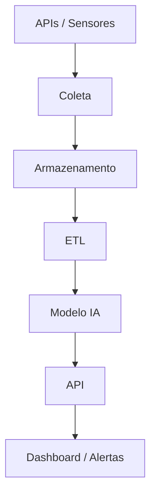

# SompoRisk AI 🤖

## 📌 Enterprise Challenge - Sprint 1 - Sompo

**Grupo:**  
- Thiese Novaes - RM572659  
- João Vitor - RM572969  
- Talles Duran - RM572772  
- Kevin Santiago - RM573808  
- Renan Souza - RM568958  

---

## 🚀 1. Visão geral do projeto

A **SompoRisk AI** é uma proposta de solução baseada em **dados e Inteligência Artificial** para identificar, prever e reduzir riscos operacionais e ambientais relacionados ao uso de equipamentos agrícolas.

O objetivo é transformar decisões reativas em decisões preventivas, permitindo que operadores, gestores e seguradoras tenham uma visão mais clara dos fatores de risco antes que um incidente aconteça.

---

## ⚠️ 2. Problema abordado

Hoje, muitas operações agrícolas ainda dependem de decisões tomadas de forma reativa, ou seja, após a ocorrência de danos, falhas ou acidentes.

Isso pode gerar:
- altos custos com sinistros;
- perda de equipamentos;
- interrupção da operação;
- baixa eficiência operacional;
- maior dificuldade para prever e evitar incidentes.

O principal problema é a falta de previsibilidade e de correlação entre fatores ambientais, operacionais e comportamentais.

---

## 💡 3. Solução proposta

A **SompoRisk AI** será uma plataforma inteligente que permitirá:

- monitoramento de fatores ambientais e operacionais;
- cálculo de score de risco em tempo real;
- geração de alertas preventivos;
- recomendações práticas para evitar incidentes;
- visualização dos riscos em dashboard por equipamento, operação e região.

### 📊 Principais saídas do sistema
- Score de risco de 0 a 100;
- Classificação de risco: Baixo, Médio ou Alto;
- Alertas em tempo real;
- Recomendações operacionais;
- Relatórios gerenciais.

### ⚙️ Critério inicial de risco alto
A proposta inicial considera maior risco quando há combinação de fatores como:
- solo úmido;
- proximidade de água;
- velocidade elevada.

> Observação: esses critérios são iniciais e podem evoluir nas próximas etapas.

---

## 👥 4. Personas

### 👨‍🌾 Operador de equipamento
**Necessidades:**
- receber alertas de risco em tempo real;
- evitar acidentes e danos.

**Solução:**
- alertas visuais e sonoros;
- recomendações práticas.

---

### 🧑‍💼 Gestor de frota
**Necessidades:**
- reduzir custos;
- priorizar manutenção.

**Solução:**
- ranking de risco;
- dashboards analíticos.

---

### 🏢 Seguradora
**Necessidades:**
- antecipar sinistros;
- entender riscos.

**Solução:**
- score por cliente/região;
- análise de fatores de risco.

---

## 🧾 5. User Stories

**Operador**
- Como operador, quero receber alertas em tempo real para evitar acidentes.

**Gestor**
- Como gestor, quero ver o ranking de risco para priorizar ações.

**Seguradora**
- Como seguradora, quero identificar padrões de risco para prever sinistros.

---

## 📊 6. Variáveis de dados

### 🌦️ Ambientais
- chuva  
- umidade do solo  
- tipo de solo  
- proximidade de água  
- inclinação  

### 🚜 Operacionais
- velocidade  
- tipo de operação  
- tempo de uso  
- rota  

### ⚙️ Equipamento
- idade  
- manutenção  
- tipo  

### 📍 Geoespacial
- latitude  
- longitude  
- mapas  

---

## 🧪 7. Dataset (exemplo)

| equipamento_id | chuva | solo_umidade | velocidade | prox_agua | operacao | risco |
|----------------|-------|--------------|------------|-----------|----------|-------|
| EQUIP001 | 30mm | alta | 18 km/h | 50m | campo | alto |
| EQUIP002 | 5mm | baixa | 10 km/h | 500m | transporte | baixo |

---

## 🤖 8. Modelagem de IA

**Objetivo:** prever risco operacional  

**Abordagem:**
- classificação (baixo, médio, alto)
- score probabilístico  

**Modelos:**
- Random Forest  
- Regressão Logística  
- XGBoost  

**Saídas:**
- probabilidade  
- classificação  
- explicação do risco  

---

## 🏗️ 9. Arquitetura

## 🛠️ 10. Tecnologias

Backend: Python, Pandas, Scikit-learn
APIs: OpenWeather, Google Maps
Storage: AWS S3, Firebase
Frontend: React, Power BI

## 🔐 11. Segurança

- autenticação
- controle de acesso
- criptografia
- logs

## 📈 12. Simulação de dados

Serão usados dados simulados baseados em:

- clima
- solo
- operação

## 📅 13. Planejamento

Sprint 2: dados + análise
Sprint 3: modelo IA
Sprint 4: dashboard
Sprint 5: protótipo

## 🎥 14. Vídeo

[https://youtu.be/HASWFShZgFs](https://youtu.be/HASWFShZgFs)

## 📝 Sobre o projeto
Documentação detalhada das fases de desenvolvimento:

- [Fases do Projeto (Funcionalidades)](./README-project.md)
- [Documentações](./docs/README-DOCS.md)

## ⭐ 15. Diferenciais
- IA explicável
- alertas inteligentes
- score em tempo real
- integração de dados

## 📌 16. Considerações finais

A solução transforma a gestão de risco agrícola de reativa para preventiva, utilizando dados e IA para reduzir custos, evitar perdas e melhorar decisões.
