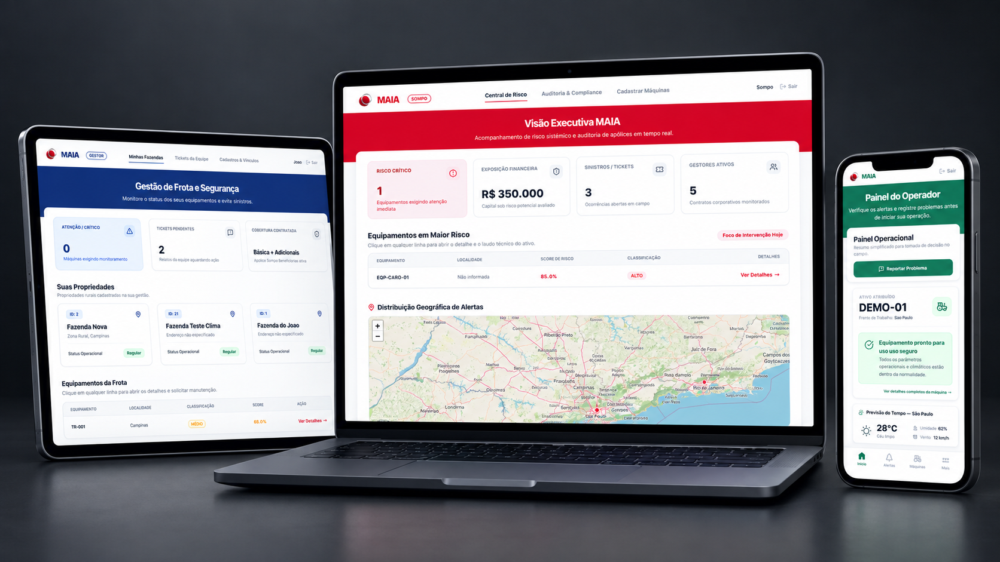

<p align="center">
  
</p>

<h1 align="center">MAIA 🌾</h1>
<h3 align="center">Monitoramento, Análise e Inteligência Agrícola</h3>
<p align="center"><i>Do conhecimento sobre a natureza à inteligência sobre o risco.</i></p>

---

A civilização maia observava o céu e os ciclos da terra para decidir com mais segurança. O MAIA segue o mesmo princípio, utilizando telemetria de sensores, dados meteorológicos e inteligência orbital no lugar da observação do céu, transformando informação agrícola em inteligência de risco para seguradoras.

## 🎯 O problema

Seguradoras de equipamentos agrícolas descobrem o sinistro apenas após a sua ocorrência. Motores superaquecendo, manutenções atrasadas e solos saturados geram sinais precursores que raramente chegam a quem decide a tempo. O resultado é o pagamento reativo de indenizações elevadas.

## 💡 A solução

Uma plataforma unificada que conecta telemetria real de máquinas (CAN/J1939), relatórios de operadores em campo e as regras da apólice (_Sompo Benfeitorias_):
$$\text{Telemetria / IoT} \longrightarrow \text{Motor de IA (Anomalia)} \longrightarrow \text{Alerta Explicado} \longrightarrow \text{Ação Preventiva} \longrightarrow \text{Auditoria por Hash}$$

---

## ⚡ Principais Funcionalidades e Diferenciais

O MAIA não é apenas um painel de monitoramento estatístico; ele implementa um ciclo completo de governança e prevenção de seguros agrícolas:

- **Motor de IA Duplo (Mecânico + Ambiental):** Combina a análise multivariada de telemetria CAN (`Isolation Forest` + `RobustScaler`) com a análise orbital de solo e terreno via satélite/radar SAR (`PCA Ambiental` com Sentinel-1, SoilGrids e Open-Meteo). Mais detalhes em [docs/MODELO_IA.md](docs/MODELO_IA.md).
- **Cadeia de Auditoria Criptográfica (Hash Chain):** Cada decisão de risco gera um hash SHA-256 encadeado ao registro anterior, garantindo imutabilidade e prova documental irrefutável para regulação e disputa de sinistros. Saiba mais em [docs/SEGURANCA_E_AUDITORIA.md](docs/SEGURANCA_AUDITORIA.md).
- **Ciclo de Feedback Humano (_Human-in-the-Loop_):** Ocorrências reportadas por operadores em campo via tickets estruturados retroalimentam automaticamente as análises de risco subsequentes da máquina.
- **Manutenção Externa por Token Único:** O gestor gera links seguros e temporários para técnicos de manutenção externos registrarem serviços em campo sem necessidade de senhas ou cadastro.
- **Exposição Financeira Real:** Cálculo dinâmico do capital sob risco em Reais (R$) cruzando o valor segurado individual de cada maquinário com o seu nível de criticidade atual.

---

## 👥 Quem usa (As 4 Personas)

| Persona                      | O que faz no sistema                                                                                                                      |
| :--------------------------- | :---------------------------------------------------------------------------------------------------------------------------------------- |
| 🏢 **Sompo (Seguradora)**    | Visão macro de carteira, exposição financeira consolidada (R$), regulação de sinistros e cadastros globais.                               |
| 👔 **Gestor de Frota**       | Gestão de propriedades rurais (fazendas), vinculação de operadores a ativos, acompanhamento de tickets e geração de ordens de manutenção. |
| 🧑‍🌾 **Operador de Campo**     | Painel operacional simplificado, alertas em linguagem natural e sistema de relatórios de falhas (tickets).                                |
| 🔧 **Técnico de Manutenção** | Acesso externo e sem fricção por link único protegido por token temporário (sem necessidade de login).                                    |

---

## 🛠️ Stack Tecnológica

| Camada               | Tecnologia                                                                       |
| :------------------- | :------------------------------------------------------------------------------- |
| **Backend**          | Python + FastAPI + Oracle Cloud                                                  |
| **Segurança**        | Autenticação JWT (24h) + Hash Bcrypt + RBAC de Duas Camadas                      |
| **Machine Learning** | Scikit-learn (Isolation Forest, RobustScaler, PCA) + SHAP                        |
| **Frontend**         | HTML5 + JavaScript (ES6 Modules) + Tailwind CSS via CDN + Leaflet.js + Plotly.js |

---

## 📚 Documentação Técnica

Para uma imersão completa em cada aspecto do projeto, consulte os documentos na pasta `docs/`:

| Documento                                                      | Conteúdo                                                                        |
| :------------------------------------------------------------- | :------------------------------------------------------------------------------ |
| [docs/CASO_DE_NEGOCIO.md](docs/CASO_DE_NEGOCIO.md)             | Valor comercial, redução de sinistralidade e impacto financeiro para a Sompo.   |
| [docs/ARQUITETURA.md](docs/ARQUITETURA.md)                     | Fluxo de dados end-to-end, diagramas, hierarquia RBAC e decisões de engenharia. |
| [docs/MODELO_IA.md](docs/MODELO_IA.md)                         | Metodologia de Machine Learning (Operacional + Ambiental), validação e limites. |
| [docs/SEGURANCA_E_AUDITORIA.md](docs/SEGURANCA_E_AUDITORIA.md) | Mecanismos de criptografia bcrypt, tokens JWT e integridade da cadeia de hash.  |
| [docs/EVOLUCAO_DO_PROJETO.md](docs/EVOLUCAO_DO_PROJETO.md)     | Trajetória evolutiva da Sprint 1 à Sprint 4 e resiliência frente aos feedbacks. |
| [docs/SENSOR_IOT.md](docs/SENSOR_IOT.md)                       | Especificação de hardware IoT, custos de componentes (BOM) e simulação.         |

> 📄 **Documentação Executiva Oficial:** Você pode baixar o [Manual Executivo em PDF](./frontend/assets/pdf/MAIA_Manual_Executivo_Tecnico.pdf), contendo o detalhamento de negócio, arquitetura, pipeline de dados e capturas de tela de todas as interfaces do sistema.

---

## 🔧 Guia de Execução Local (Para a Banca e Desenvolvedores)

Siga este passo a passo validado para executar o projeto do zero em sistemas **macOS** ou **Windows**:

### 1. Pré-requisitos

- **Python 3.11 ou 3.12** instalado na máquina.
- Acesso à rede/internet (para conexão com o banco Oracle Cloud da FIAP).

### 2. Clonar o Repositório e Configurar o Ambiente Virtual

```bash
git clone https://github.com/renansouz/maia-intelligence-NEXT.git
cd maia-intelligence-NEXT
```

- **No macOS / Linux (Terminal):**
  ```bash
  python3.12 -m venv venv
  source venv/bin/activate
  ```
- **No Windows (PowerShell):**
  ```powershell
  py -3.12 -m venv venv
  .\venv\Scripts\Activate.ps1
  ```

### 3. Instalar Dependências

```bash
pip install -r requirements.txt
```

### 4. Configurar as Variáveis de Ambiente

Copie o arquivo de exemplo e preencha com suas credenciais:

```bash
cp .env.example .env
```

Abra o arquivo `.env` gerado e configure os seguintes parâmetros:

```env
ORACLE_USER="USER"
ORACLE_PASSWORD="PASSWORD"
ORACLE_HOST="HOST"
ORACLE_PORT=0
ORACLE_SERVICE="SERVICE"

ADMIN_EMAIL="email@gmail.com"
ADMIN_SENHA="senha-forte@00"

GEE_PROJECT_ID="YOUR_GEE_PROJECT_ID"

API_KEY="alguma-chave-forte"
```

> _Nota sobre os dados brutos de ML:_ Os arquivos pesados de treino (`machine_learning/data/raw/`) não sobem para o GitHub por limitação de tamanho. Caso precise reexecutar o EDA e treinar do zero, baixe a pasta raw compactada através do link oficial disponibilizado pela equipe: [Baixar Datasets Brutos (Google Drive)](https://drive.google.com/drive/folders/1SrGvyjMPSpCWfd-7neeYEIzf21OOxZXL?usp=sharing). Se for apenas para testar a aplicação web, **não é necessário baixar esses arquivos**, pois o modelo final treinado já está empacotado em `ml_assets/`.

### 5. Sincronizar o Banco de Dados (Obrigatório)

Execute o comando abaixo para criar automaticamente todas as tabelas e restrições no Oracle Cloud:

- **No Windows:**
  ```powershell
  python -m app.core.config_db
  ```
- **No macOS / Linux:**
  ```bash
  python3 -m app.core.config_db
  ```

### 6. Popular Dados de Demonstração (Opcional, mas Altamente Recomendado para Avaliação)

Para preencher o sistema com gestores, fazendas, frotas de tratores e um histórico de ocorrências para a banca testar imediatamente:

- **No Windows:**
  ```powershell
  python -m scripts.popular_demo
  ```
- **No macOS / Linux:**
  ```bash
  python3 -m scripts.popular_demo
  ```

_(Caso queira iniciar com o sistema 100% limpo, basta não executar este comando)._

### 7. Iniciar o Servidor da Aplicação

- **No Windows:**
  ```powershell
  python -m uvicorn app.main:app --reload
  ```
- **No macOS / Linux:**
  ```bash
  uvicorn app.main:app --reload
  ```

Abra o navegador e acesse: **`http://127.0.0.1:8000/login.html`**

---

<p align="center"><i>Enterprise Challenge — FIAP & Sompo Seguros — 2026</i></p>
