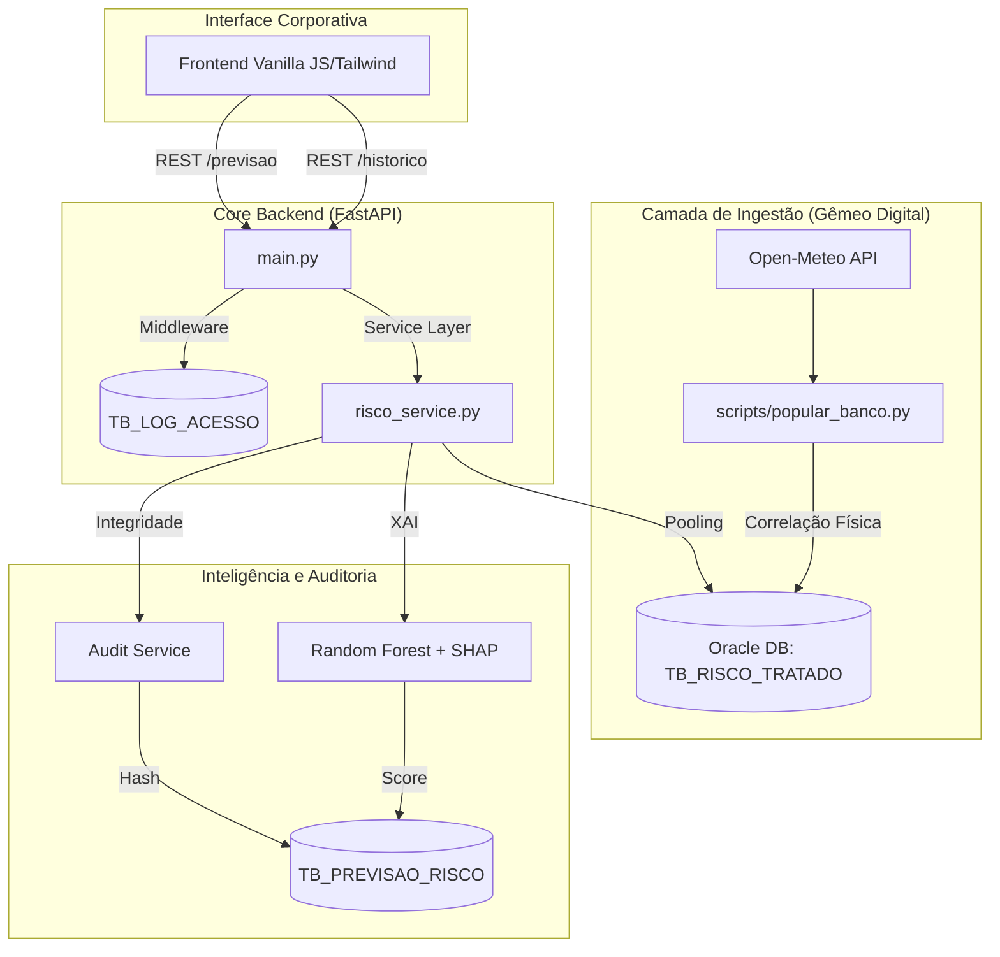

# 📐 Arquitetura do Ecossistema MAIA

O sistema MAIA foi projetado seguindo o princípio de **Responsabilidade Única** e **Desacoplamento**, permitindo que a inteligência de dados evolua independentemente da interface de visualização.

## 🏗️ Diagrama de Solução (Ponta a Ponta)

## 🛠️ Decisões de Engenharia

### 1. Transição: Streamlit para Vanilla JS + Tailwind

Embora o Streamlit seja eficiente para protótipos rápidos, optamos pela migração para um **Frontend Estático** consumindo API REST.

- **Justificativa:** Garantir o controle total sobre a identidade visual da Sompo e eliminar o gargalo de re-renderização do Streamlit, proporcionando uma experiência de SPA (Single Page Application) fluida e de baixa latência.

### 2. FastAPI e Session Pooling

Diferente de scripts sequenciais, o backend utiliza o `oracledb.SessionPool`.

- **Justificativa:** Conexões com banco de dados Oracle são custosas. O pooling mantém conexões "vivas", permitindo que o sistema suporte múltiplas requisições simultâneas durante a operação de frota sem degradação de performance.

### 3. Middleware de Rastreabilidade

Implementamos um interceptor nativo no FastAPI que registra cada transação na tabela `TB_LOG_ACESSO`.

- **Justificativa:** Cumprir o requisito de conformidade da Sprint 3, permitindo auditoria técnica de quem acessou qual recurso, tempo de resposta e IP de origem.

### 4. Auto-Migration (config_db.py)

O sistema detecta o estado do banco no startup e aplica as correções de schema (colunas e PKs) automaticamente.

- **Justificativa:** Garantir que o projeto seja "Zero-Touch" para a banca examinadora e para o time de infraestrutura da Sompo.
