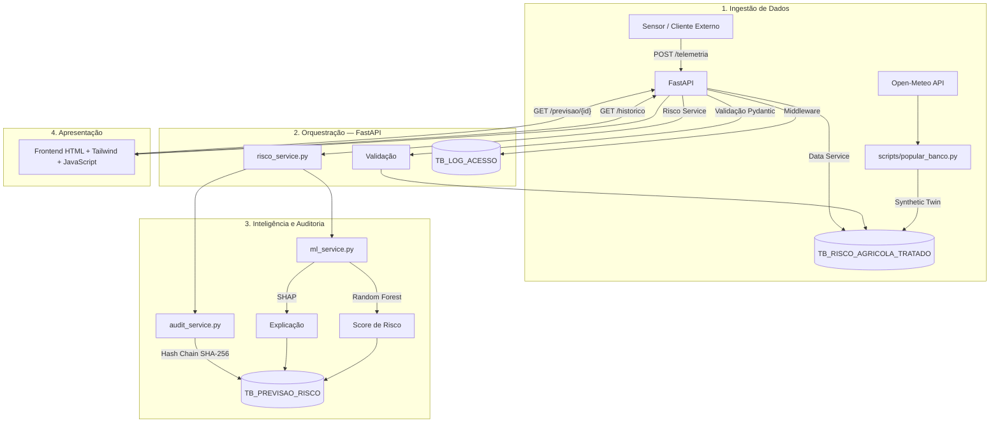

# 📐 Arquitetura do MAIA

## Visão Geral

O MAIA foi estruturado em quatro camadas principais:

1. **Ingestão de Dados** — recebe dados ambientais e operacionais;
2. **Orquestração** — valida, persiste e coordena os serviços;
3. **Inteligência e Auditoria** — gera o score, a explicação e o registro íntegro da decisão;
4. **Apresentação** — disponibiliza os resultados para os usuários por meio de uma interface web.

A arquitetura utiliza o **FastAPI como camada de orquestração**, o **Oracle Database como camada de persistência**, o **Random Forest + SHAP como motor de inteligência** e uma **Hash Chain para integridade das previsões armazenadas**.



## 🔄 Fluxo de Dados

O MAIA trabalha com dois contextos de entrada.

### 1. Ingestão operacional

O endpoint:

```text
POST /telemetria
```

recebe dados de um equipamento ou cliente externo, valida a estrutura da informação por meio de **Pydantic** e realiza a persistência conforme o fluxo definido pela aplicação.

Esse endpoint representa a porta de entrada para uma futura integração com fontes reais de telemetria.

### 2. Geração do ambiente de demonstração

O script:

```text
scripts/popular_banco.py
```

combina dados climáticos da **Open-Meteo** com a telemetria do **Synthetic Twin**, gerando o histórico utilizado no ambiente atual de treinamento, validação e demonstração.

Os dois contextos utilizam a mesma camada de persistência e os mesmos contratos de dados da aplicação, mantendo uma estrutura preparada para substituir a origem simulada por fontes reais.

---

## 🧩 Fluxo de Predição

A consulta de uma previsão percorre o seguinte fluxo:

```text
Requisição
    ↓
FastAPI
    ↓
Validação / Autenticação
    ↓
Risco Service
    ↓
Random Forest
    ↓
SHAP
    ↓
Score + Classificação + Explicação
    ↓
Hash de Auditoria
    ↓
Oracle
    ↓
Resposta da API
    ↓
Frontend
```

O resultado entregue ao usuário combina quatro elementos:

- **score probabilístico**;
- **classificação de risco**;
- **explicação dos fatores relevantes**;
- **hash de auditoria associado à previsão**.

Dessa forma, a mesma decisão pode ser visualizada e posteriormente rastreada.

---

## ⚙️ Decisões de Engenharia

### FastAPI como orquestrador central

O FastAPI concentra os endpoints da aplicação e coordena a comunicação entre validação, persistência, serviços de negócio, Machine Learning e auditoria.

Essa centralização reduz o acoplamento entre frontend, banco e modelo e mantém o acesso às camadas internas controlado pela API.

### Contratos de API com Pydantic

As entradas recebidas pela aplicação são validadas por schemas Pydantic antes de serem processadas.

Isso cria um contrato explícito para os dados que entram no sistema e reduz a possibilidade de informações incompatíveis chegarem às camadas de persistência ou inteligência.

### Frontend desacoplado

O frontend é servido como conteúdo estático pelo FastAPI e se comunica com o backend exclusivamente por API REST.

A interface não acessa diretamente o Oracle e não contém a lógica de negócio do sistema.

A escolha por HTML, Tailwind CSS e JavaScript foi deliberada para manter a solução simples de executar e permitir controle direto sobre a identidade visual adotada para o MAIA.

### Session Pooling no Oracle

A camada de acesso ao banco utiliza `oracledb` com **Session Pooling**.

Em vez de estabelecer uma nova conexão para cada requisição, a aplicação reutiliza conexões do pool, reduzindo o custo operacional associado à criação e encerramento frequente de sessões.

A configuração está centralizada em:

```text
app/core/database.py
```

### Persistência em Oracle

O Oracle armazena:

- dados tratados da operação;
- previsões geradas;
- explicações associadas às previsões;
- hashes de integridade;
- logs de acesso da API.

Essa centralização permite manter histórico e rastreabilidade dentro do mesmo ambiente de dados.

### Migração de Schema

O módulo:

```text
app/core/config_db.py
```

verifica a estrutura necessária do banco e aplica ajustes de schema quando necessário.

A abordagem é **idempotente**, permitindo que o ambiente seja preparado de forma consistente sem depender exclusivamente de alterações manuais.

Essa decisão surgiu como resposta aos problemas de sincronização de schema encontrados durante o desenvolvimento.

### Middleware de Rastreabilidade

Toda requisição recebida pela API passa por um middleware que registra em `TB_LOG_ACESSO`:

- método HTTP;
- rota;
- status da resposta;
- IP de origem;
- tempo de processamento.

Esse mecanismo registra o **uso da aplicação**.

Ele é complementar à Hash Chain, que registra a **integridade das decisões armazenadas**.

---

## 🔐 Camada de Segurança

Os endpoints protegidos utilizam autenticação por API Key através do header:

```text
X-API-KEY
```

A validação adota comportamento **fail-closed**:

- sem chave configurada, o acesso não é liberado;
- chave inválida resulta em rejeição;
- a credencial do backend permanece em variável de ambiente.

A interface frontend utiliza uma configuração própria e não acessa diretamente as credenciais do Oracle.

Os mecanismos de integridade e auditoria estão detalhados em:

```text
docs/SECURITY.md
```

---

## 🧠 Inteligência e Auditoria

A camada de serviços separa a responsabilidade entre:

```text
ml_service.py
```

Responsável por:

- carregar o modelo treinado;
- realizar a inferência;
- calcular a explicação SHAP.

```text
audit_service.py
```

Responsável por:

- recuperar o hash anterior;
- gerar o novo hash;
- preservar o encadeamento das previsões.

Essa separação permite evoluir o modelo sem misturar sua lógica com a camada de auditoria.

O resultado final armazenado em `TB_PREVISAO_RISCO` associa:

```text
Equipamento
+ Score
+ Classificação
+ Explicação
+ Hash
```

---

## 🗂️ Estrutura de Diretórios

```text
app/
├── core/
│   ├── database.py
│   └── config_db.py
├── models/
│   └── schemas Pydantic
├── services/
│   ├── ml_service.py
│   ├── audit_service.py
│   └── data services
└── main.py

frontend/
├── assets/
├── css/
├── js/
└── index.html

machine_learning/
└── treinar_modelo.py

ml_assets/
└── modelo treinado

scripts/
├── validacao/
├── popular_banco.py
└── popular_previsoes_historicas.py
```

---

## 📈 Capacidade de Evolução

A arquitetura foi organizada para permitir evolução sem substituir o núcleo do sistema.

### Fonte de dados

```text
Synthetic Twin
      ↓
Telemetria real / IoT
```

A camada de ingestão pode evoluir de dados simulados para dispositivos reais mantendo o restante do pipeline.

### Modelo

```text
Random Forest
      ↓
Novos modelos / versões
```

O modelo é encapsulado na camada de inteligência, permitindo testar novos algoritmos sem alterar a interface do usuário ou a estrutura de persistência.

### Apresentação

```text
Frontend atual
      ↓
Web App / Portal Sompo / Aplicação integrada
```

Como o frontend consome a API REST, uma futura substituição da camada visual não exige alterações na lógica central do sistema.

---

## 🎯 Arquitetura em Uma Frase

> **O MAIA transforma dados ambientais e operacionais em uma decisão de risco explicável, persistida e rastreável.**

A arquitetura completa pode ser resumida como:

```text
ENTRADA
   ↓
VALIDAÇÃO
   ↓
PERSISTÊNCIA
   ↓
PREDIÇÃO
   ↓
EXPLICAÇÃO
   ↓
AUDITORIA
   ↓
DECISÃO
```

Essa integração é o ponto central da Sprint 3: transformar os componentes desenvolvidos nas etapas anteriores em um fluxo único de ponta a ponta.
