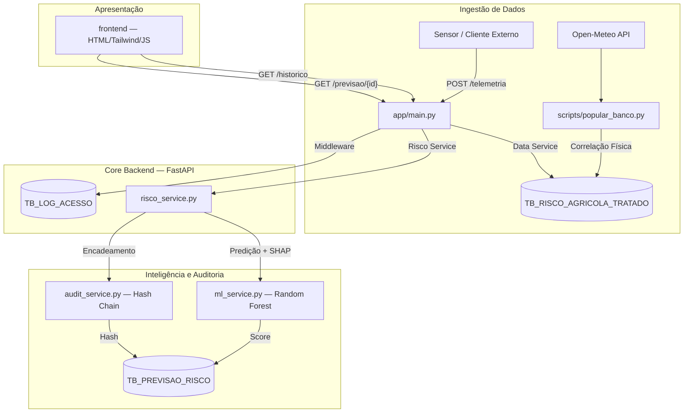

# 📐 Arquitetura do MAIA

## Visão Geral do Fluxo de Dados

O MAIA é dividido em quatro camadas com responsabilidades isoladas: ingestão, orquestração, inteligência e apresentação. Cada camada se comunica apenas através de contratos bem definidos (API REST), o que permite que qualquer uma delas evolua sem quebrar as demais.



## Fluxo de Entrada de Dados

Existem dois caminhos de entrada, com propósitos diferentes:

- **`POST /telemetria`** — endpoint de ingestão em tempo real. Recebe uma leitura de sensor/equipamento, valida via Pydantic e persiste em `TB_RISCO_AGRICOLA_TRATADO`. É o caminho que representa a operação real do sistema em produção.
- **`scripts/popular_banco.py`** — gera o histórico da frota simulada (50 equipamentos fixos, 5 cidades), combinando clima real (Open-Meteo) com telemetria sintética correlacionada. Usado para construir a base de treino do modelo e popular o ambiente de demonstração.

Os dois caminhos convergem na mesma tabela e no mesmo pipeline de inferência — não existe lógica duplicada entre ingestão em tempo real e ingestão em lote.

## Decisões de Engenharia

### FastAPI como orquestrador central

Toda a lógica de negócio (validação, chamada ao modelo, geração de hash, persistência) passa por um único ponto de entrada. Isso garante que qualquer cliente — o frontend, um script de teste, ou um sistema externo da Sompo — receba exatamente o mesmo tratamento e as mesmas garantias de segurança e auditoria.

### Frontend desacoplado (HTML + Tailwind + JavaScript)

O frontend é servido como arquivos estáticos pelo próprio FastAPI (`StaticFiles`) e se comunica com o backend exclusivamente via API REST, sem nunca ter acesso direto ao banco de dados ou às credenciais do Oracle. Essa separação significa que a interface pode ser hospedada separadamente do backend no futuro, sem qualquer alteração na lógica de negócio.

A ausência de um framework de frontend (React, Vue) foi uma escolha deliberada: sem processo de build, sem `node_modules`, sem passo de compilação — o projeto roda com um único comando, e o controle sobre a identidade visual da Sompo é total.

### Session Pooling no Oracle

Conexões com banco de dados relacional têm custo de abertura não-trivial. O `app/core/database.py` mantém um `SessionPool` do `oracledb`, reaproveitando conexões entre requisições em vez de abrir e fechar uma nova a cada chamada — essencial para que a API suporte múltiplas requisições simultâneas sem degradação.

### Migração de schema automática (`config_db.py`)

Ao subir, o backend verifica o estado real das tabelas no Oracle — quais existem, quais colunas faltam, se as chaves primárias estão corretas — e aplica as correções necessárias via `ALTER TABLE`, de forma idempotente. Isso garante que o projeto rode de forma consistente independentemente do estado anterior do banco, sem exigir intervenção manual de quem for executá-lo.

### Middleware de rastreabilidade

Toda requisição HTTP que chega à API é interceptada por um middleware que registra método, rota, status de resposta, IP de origem e tempo de processamento em `TB_LOG_ACESSO`. Isso é independente do hash chain de auditoria de decisões — o middleware rastreia _acesso ao sistema_, o hash chain garante _integridade do dado gravado_. São camadas complementares de rastreabilidade.

## Estrutura de Diretórios

```
app/
├── core/ → conexão Oracle, migração de schema
├── models/ → schemas Pydantic (contratos da API)
├── services/ → lógica de negócio (ML, auditoria, dados)
└── main.py → ponto de entrada, rotas e middleware

frontend/
├── assets/ → identidade visual (logo)
├── css/ → estilos
├── js/ → lógica da aplicação (uma view por arquivo)
└── index.html

machine_learning/
└── treinar_modelo.py → geração do modelo (fonte de treino)

ml_assets/ → binários do modelo treinado, versionados no Git

scripts/
├── validacao/ → benchmarks e provas científicas
├── popular_banco.py
└── popular_previsoes_historicas.py
```

## Segurança de Acesso

Todos os endpoints exigem uma API Key válida via header `X-API-KEY`. A validação é **fail-closed**: se a chave não estiver configurada no ambiente, ou não bater com a enviada, o acesso é bloqueado — o sistema nunca assume acesso liberado por ausência de configuração. Detalhes matemáticos de segurança e auditoria estão em [SECURITY.md](./SECURITY.md).
