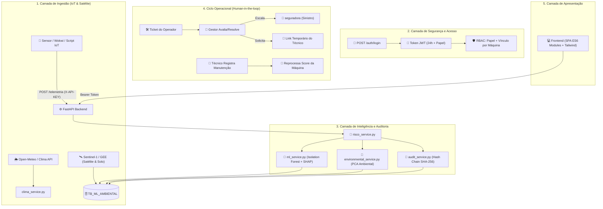

# 🏗️ MAIA — Arquitetura do Sistema

Este documento descreve a arquitetura técnica do MAIA, detalhando as camadas do sistema, o fluxo de dados de ponta a ponta, os contratos de segurança e as decisões de engenharia que sustentam a plataforma.

---

## 🧭 Visão Sistêmica e Camadas

O MAIA é estruturado em camadas desacopladas, integrando a coleta física de dados IoT e inteligência orbital até a visualização executiva por persona:

---

## 🔄 Fluxo de uma Decisão de Risco (End-to-End)

1. **Ingestão:** Dados de telemetria CAN (temperatura, RPM, torque, pressões) chegam via `POST /telemetria` validados por chave de dispositivo e gravados em `TB_RISCO_AGRICOLA_TRATADO`.
2. **Validação:** O FastAPI utiliza schemas Pydantic (`schemas.py`) para garantir a integridade estrutural das entradas.
3. **Inferência Dupla de IA:** 
   - **Operacional:** O `ml_service.py` avalia os sinais CAN via *Isolation Forest* e *RobustScaler*.
   - **Ambiental:** O `environmental_service.py` cruza a coordenada da fazenda com a base geoespacial pré-processada em `TB_ML_AMBIENTAL` aplicando o modelo *PCA* não supervisionado.
4. **Auditoria Criptográfica:** O `audit_service.py` gera um hash SHA-256 encadeado ao registro anterior, garantindo imutabilidade histórica em `TB_PREVISAO_RISCO`.
5. **Entrega Baseada em Papel:** O resultado consolidado (mecânico + ambiental + tickets) é entregue à interface de acordo com as permissões restritas da persona logada.

---

## 🔐 Segurança e Governança de Acesso

- **Autenticação Baseada em Hash e Token:** Senhas protegidas por **hash bcrypt**. Sessões controladas por **Tokens JWT** com expiração de 24 horas.
- **Autorização em Duas Camadas (RBAC):** O sistema valida não apenas o papel do usuário (`SEGURADORA`, `GESTOR`, `OPERADOR`), mas também se o usuário possui vínculo relacional direto com o ativo consultado.
- **Isolamento do Técnico Externo:** O técnico de manutenção acessa a plataforma exclusivamente via link com token único e uso restrito, sem necessidade de credenciais de login.

---

## 🗂️ Modelo de Dados (Oracle Cloud)

O banco relacional gerencia a hierarquia corporativa, os fluxos operacionais e o histórico analítico através das seguintes tabelas principais:

- **`TB_USUARIO`**: Credenciais, papéis e vínculos hierárquicos.
- **`TB_FAZENDA`**: Propriedades rurais vinculadas aos gestores com coordenadas geográficas.
- **`TB_MAQUINA`**: Ativos monitorados, valores segurados e vínculo com fazendas.
- **`TB_MAQUINA_OPERADOR`**: Relacionamento N para N entre operadores e equipamentos.
- **`TB_TICKET`**: Ocorrências de campo abertas por operadores.
- **`TB_MANUTENCAO`**: Ordens de serviço e histórico de intervenções mecânicas.
- **`TB_PREVISAO_RISCO`**: Scores calculados, explicações textuais e hashes de auditoria encadeados.
- **`TB_ML_AMBIENTAL`**: Repositório de features geoespaciais e ambientais coletadas via satélite (Sentinel-1/2, GEE, SoilGrids).

---

## ⚙️ Decisões Técnicas Principais

- **FastAPI:** Escolhido pela tipagem estática (Pydantic), documentação nativa (Swagger) e suporte assíncrono para operações de ML e banco.
- **Oracle Cloud:** Plataforma transacional oficial da instituição, operada via pool de conexões otimizado (`database.py`).
- **Hash Chain de Auditoria:** Garante que qualquer adulteração manual no histórico de previsões seja matematicamente detectável por auditoria sob demanda.
- **Frontend sem Build Step:** Utilização de ES6 Modules nativos com Tailwind via CDN, garantindo agilidade extrema no desenvolvimento e facilidade de demonstração ao vivo.

---

_Documentação oficial de arquitetura — Challenge NEXT FIAP 2026._
