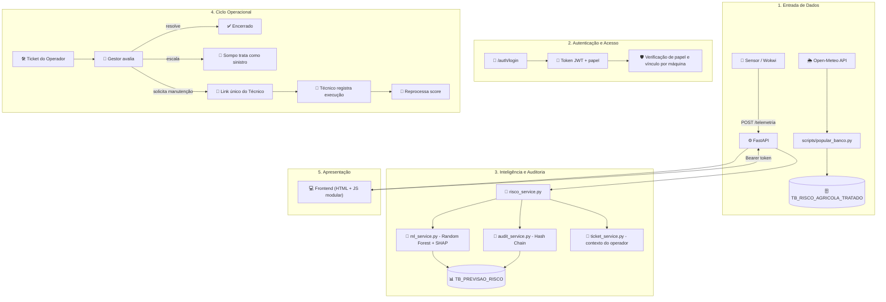

# 🏗️ MAIA - Arquitetura

Este documento descreve como o MAIA é construído por dentro: as camadas do sistema, o fluxo de dados de ponta a ponta, e as decisões técnicas que sustentam cada parte. A ideia é que qualquer pessoa consiga entender rapidamente como as peças se encaixam.

---

## 🧭 Visão geral

O MAIA é organizado em quatro camadas principais, com uma hierarquia de acesso (Sompo → Gestor → Operador, mais o Técnico sem login) atravessando todas elas:



---

## 🔄 Fluxo de uma decisão de risco

```
 Telemetria chega (sensor real ou histórico populado)
        ↓
 Validação (Pydantic)
        ↓
 Persistência (Oracle, sempre um novo registro)
        ↓
 Predição (Random Forest)
        ↓
 Explicação (SHAP, traduzida para linguagem simples)
        ↓
 Contexto de tickets abertos é anexado à explicação
        ↓
 Hash de auditoria é gerado, encadeado ao anterior
        ↓
 Resposta entregue à interface certa, de acordo com o papel de quem está vendo
```

Cada etapa é isolada em seu próprio módulo de serviço - isso significa que o modelo de IA pode evoluir (novas variáveis, novo algoritmo) sem que a camada de auditoria ou a API precisem mudar uma linha.

---

## 🔐 Camada de Acesso

| Papel           | O que enxerga                                                                         |
| --------------- | ------------------------------------------------------------------------------------- |
| 🏢 **Sompo**    | Todos os gestores, todas as máquinas, exposição financeira total, sinistros escalados |
| 👔 **Gestor**   | Suas propriedades, suas máquinas, seus operadores, tickets da própria equipe          |
| 🧑‍🌾 **Operador** | Apenas a(s) máquina(s) vinculada(s) a ele                                             |
| 🔧 **Técnico**  | Nenhum login - acesso único por link com token temporário                             |

A autenticação usa **JWT** (token assinado, com papel embutido e expiração de 24h), e cada rota da API confere duas coisas antes de responder: o papel do usuário **e** se ele realmente tem vínculo com o recurso pedido (por exemplo, um Gestor só processa a previsão de uma máquina que está numa fazenda dele).

---

## 🗂️ Estrutura de pastas

```
app/
├── core/
│   ├── database.py          pool de conexões Oracle
│   └── config_db.py         criação e migração de schema
├── models/
│   └── schemas.py           contratos de entrada/saída (Pydantic)
├── services/
│   ├── auth_service.py      hash de senha, JWT, controle de papel
│   ├── user_service.py      cadastro e hierarquia de usuário
│   ├── fazenda_service.py   propriedades e geocodificação
│   ├── maquina_service.py   cadastro, vínculos, controle de acesso, histórico
│   ├── ticket_service.py    relatos do operador e escalonamento
│   ├── manutencao_service.py  link externo do técnico
│   ├── clima_service.py     previsão e alerta climático
│   ├── cobertura_service.py  catálogo de apólice
│   ├── data_service.py      telemetria
│   ├── processamento_service.py  indicadores de risco
│   ├── ml_service.py        modelo de IA e explicabilidade
│   ├── audit_service.py     cadeia de hash
│   └── risco_service.py     orquestrador central
└── main.py                  rotas da API

frontend/
├── login.html                autenticação
├── index.html                 aplicação principal (SPA)
├── manutencao.html           página isolada do técnico
└── js/
    ├── core/                 (auth, api, router)
    └── views/                (telas por persona)
```

---

## ⚙️ Decisões técnicas (e por quê)

**FastAPI como orquestrador central.** Documentação automática (Swagger), validação nativa via Pydantic, e desempenho assíncrono - resolve bem a mistura de rotas de leitura simples e rotas que disparam processamento de ML.

**Oracle com pool de conexões.** Ambiente já disponibilizado pela instituição, com boa maturidade para carga transacional. O pool evita o custo de abrir/fechar conexão a cada requisição.

**Chave substituta (ID auto-incremento) em vez de chave composta.** As tabelas de telemetria e previsão usam um identificador sequencial próprio como chave primária, em vez de combinar equipamento + data - isso permite múltiplas leituras e múltiplas previsões por dia, refletindo como um sensor de verdade se comporta.

**Hash encadeado para auditoria.** Cada previsão carrega um hash calculado a partir do próprio conteúdo mais o hash da previsão anterior - qualquer alteração num registro histórico quebra a cadeia a partir daquele ponto, tornando adulteração detectável. Um endpoint dedicado permite verificar a integridade de toda a cadeia a qualquer momento.

**JWT em vez de chave única compartilhada.** Dá identidade real a cada acesso - essencial para um sistema com quatro perfis diferentes e regras de visibilidade distintas entre eles. A única exceção deliberada é a ingestão de telemetria (`/telemetria`), que usa uma chave de dispositivo simples, porque quem chama essa rota é um sensor, não uma pessoa autenticando-se.

**Frontend sem framework, com módulos ES6.** Mantém o projeto leve e sem necessidade de etapa de build, o que facilita tanto o desenvolvimento em equipe quanto a apresentação ao vivo (sem dependência de processo de compilação no dia do pitch).

**Retroalimentação humana no modelo.** Tickets abertos por operadores entram no contexto da explicação gerada na próxima previsão - uma escolha de arquitetura que conecta deliberadamente a camada de machine learning à camada operacional humana, em vez de tratá-las como mundos separados.

---

## 📈 Capacidade de evolução

A arquitetura foi pensada para crescer sem precisar de reconstrução:

- **Fonte de dado:** hoje mistura dado real de clima com telemetria simulada; a mesma camada de ingestão aceita substituição por sensor físico real (ESP32/Wokwi) sem mudar nada rio abaixo.
- **Modelo:** encapsulado em `ml_service.py` - trocar o algoritmo ou adicionar novas variáveis (como um indicador de estabilidade ou temperatura de motor) não exige tocar em API, auditoria ou frontend.
- **Cobertura e regras de negócio:** o catálogo de apólice está isolado em `cobertura_service.py`, pronto para crescer com mais planos ou regras específicas por região sem afetar o resto do sistema.
