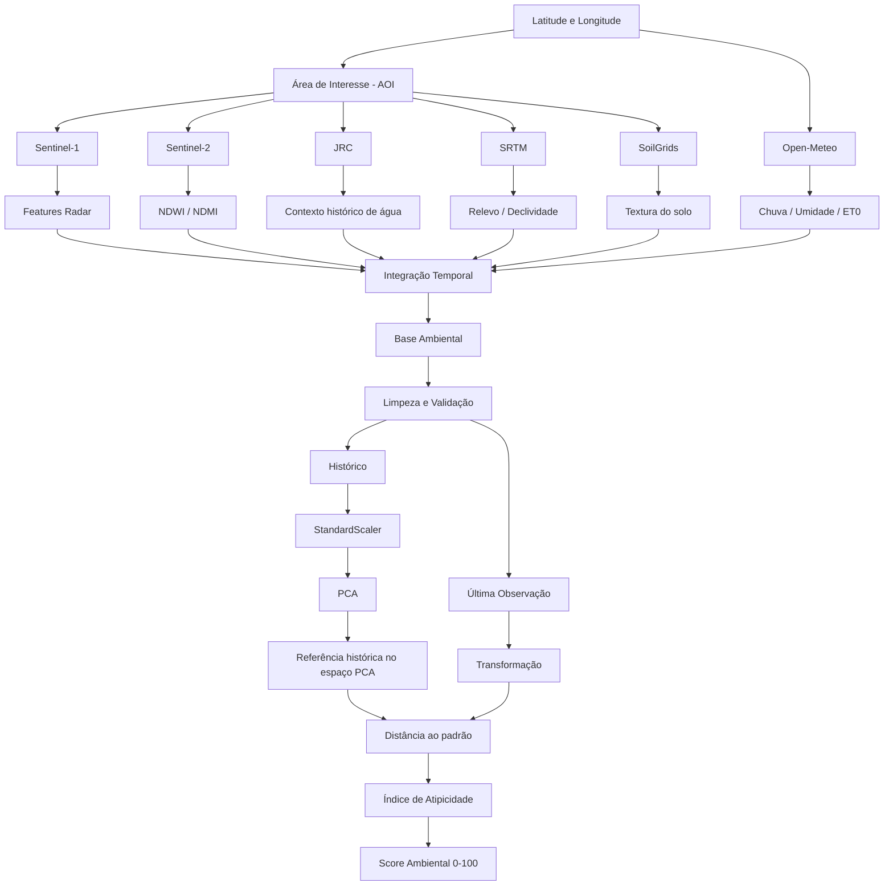

# MAIA — Score Ambiental com PCA

## 1. Visão geral

O **Score Ambiental do MAIA** foi criado para transformar diversas informações ambientais, espaciais e temporais em uma medida única de **proximidade em relação ao comportamento histórico conhecido de uma área**.

A implementação consolidada desta etapa recebeu o nome:

```text
maia_score_ambiental_pca
```

A ideia central não é tentar responder diretamente se uma condição ambiental é “boa” ou “ruim”. O objetivo é responder uma pergunta mais segura e tecnicamente sustentada pelos dados disponíveis:

> **A condição ambiental observada agora é parecida ou diferente do padrão histórico que conhecemos para essa área?**

Essa diferença é importante porque, hoje, não possuímos um *target* ambiental real que permita ensinar ao modelo quais combinações representam risco operacional real. Por isso, o problema foi tratado como **não supervisionado**, utilizando **PCA — Principal Component Analysis**.

---

## 2. Por que criamos um score ambiental?

A condição de operação de uma máquina agrícola não depende somente da própria máquina.

O terreno e o ambiente também mudam ao longo do tempo. Entre os fatores relevantes estão:

- chuva recente;
- umidade ambiental e do solo estimada por modelos meteorológicos;
- resposta da superfície observada por radar;
- presença relativa de água observada por satélite óptico;
- relevo;
- declividade;
- textura do solo;
- proximidade histórica de água.

Analisar uma única variável isoladamente seria simplificar demais o problema.

Por exemplo:

```text
chuva alta
```

sozinha não descreve completamente a condição do terreno.

A mesma quantidade de chuva pode produzir respostas diferentes dependendo de:

```text
chuva
   +
tipo de solo
   +
relevo
   +
condição anterior
   +
vegetação
   +
resposta observada por satélite
```

Por isso, desde a EDA, a proposta foi construir uma **visão ambiental multivariável**.

---

## 3. A EDA como base de toda a análise

O Score Ambiental não nasceu diretamente do PCA.

Antes da modelagem, foi criada uma **EDA Ambiental** para entender:

1. quais fontes de dados realmente estavam disponíveis;
2. como cada variável deveria ser interpretada;
3. quais informações mudavam com o tempo;
4. quais eram praticamente estáticas;
5. como diferentes fontes poderiam ser alinhadas temporalmente;
6. quais dados tinham qualidade suficiente para entrar em uma modelagem.

A EDA utiliza dados reais e rastreáveis provenientes de:

- Google Earth Engine;
- Sentinel-1;
- Sentinel-2;
- JRC Global Surface Water;
- SRTM;
- SoilGrids;
- Open-Meteo.

O papel da EDA foi evitar que o modelo recebesse variáveis sem contexto ou que uma fonte fosse interpretada de maneira incorreta.

---

# 4. Fontes de dados e por que usamos cada uma

## 4.1 Sentinel-1 — radar SAR

O Sentinel-1 utiliza radar SAR em banda C.

As principais informações usadas são:

```text
VV
VH
VV - VH
ângulo de incidência
direção da órbita
```

Também são calculadas anomalias relativas:

```text
VV_anomaly_db
VH_anomaly_db
```

Essas anomalias representam quanto a observação atual se afastou do comportamento habitual observado para aquela geometria de aquisição.

### Por que usamos?

O radar tem uma vantagem importante: ele não depende de iluminação solar e é menos limitado por cobertura de nuvens do que sensores ópticos.

Ele permite acompanhar **mudanças na resposta da superfície ao longo do tempo**.

### Interpretação correta

VV e VH não são tratados como medição direta de umidade.

O sinal também pode variar por:

- vegetação;
- rugosidade;
- geometria;
- ângulo de incidência;
- direção da órbita.

Por isso, o MAIA utiliza o radar como **parte de um contexto multivariável**, e não como uma regra isolada.

---

## 4.2 Sentinel-2 — informação óptica

Do Sentinel-2 extraímos principalmente:

```text
NDWI
NDMI
```

### NDWI

É utilizado como contexto relacionado à presença relativa de água superficial.

### NDMI

É utilizado como contexto relacionado ao conteúdo de água na vegetação/cobertura.

### Por que usamos?

O Sentinel-2 complementa o radar com uma visão óptica da superfície.

Radar e imagem óptica observam fenômenos diferentes. Quando combinados, entregam uma representação mais completa da condição ambiental.

### Limitação

O Sentinel-2 sofre influência de nuvens.

Por isso, o sistema não inventa uma observação óptica quando não existe uma imagem válida.

Para cada passagem Sentinel-1, buscamos a observação Sentinel-2 válida temporalmente mais próxima dentro de uma tolerância configurada.

Também guardamos:

```text
s2_time_distance_days
```

Isso indica quantos dias separam a imagem óptica da observação radar.

---

## 4.3 Open-Meteo — histórico meteorológico

O Open-Meteo é utilizado por meio da API histórica para coletar informações como:

```text
precipitation_mm
rain_3d_mm
rain_7d_mm
rain_14d_mm
days_since_rain_ge_1mm
soil_moisture_0_7cm_mean_m3_m3
soil_moisture_anomaly_m3_m3
et0_mm
```

### Por que chuva acumulada em várias janelas?

A chuva do próprio dia não representa todo o contexto.

Um terreno pode continuar apresentando efeitos de precipitações anteriores.

Por isso trabalhamos com memória temporal:

```text
3 dias
7 dias
14 dias
```

Também calculamos quantos dias se passaram desde uma chuva relevante.

### Umidade do solo

A umidade proveniente do Open-Meteo é utilizada como **referência de reanálise/modelagem meteorológica**.

Ela não é tratada como uma medição de sensor instalado fisicamente no terreno.

---

## 4.4 JRC Global Surface Water

O JRC adiciona contexto histórico de água.

Entre as informações utilizadas estão:

```text
ocorrência histórica de água
recorrência
sazonalidade
distância até água histórica
```

### Por que usamos?

Dois pontos geograficamente próximos podem possuir relações completamente diferentes com corpos d'água.

Essa informação ajuda a caracterizar o contexto espacial da área.

Importante:

> proximidade histórica de água é contexto geoespacial e não confirmação de uma condição atual.

---

## 4.5 SRTM — relevo e topografia

A partir do SRTM são extraídas informações como:

```text
elevação média
declividade
elevação relativa
relevo local
```

### Por que usamos?

A topografia altera a resposta do terreno.

Uma área plana, uma encosta e uma região mais baixa em relação à vizinhança podem responder de formas diferentes ao mesmo evento meteorológico.

Por isso, não utilizamos regras simplistas como:

```text
menor elevação = condição ruim
```

O relevo entra como **contexto adicional**.

---

## 4.6 SoilGrids — propriedades do solo

O SoilGrids fornece estimativas espaciais de propriedades como:

```text
argila
areia
silte
densidade aparente
carbono orgânico
```

### Por que usamos?

A textura do solo influencia características como retenção e drenagem.

Essa informação ajuda a explicar por que dois locais submetidos à mesma chuva podem apresentar comportamentos ambientais diferentes.

### Limitação

SoilGrids é uma estimativa espacial em grade.

Ele não substitui análise laboratorial realizada diretamente na propriedade.

---

# 5. Como as diferentes fontes são integradas

Cada fonte possui uma frequência diferente.

Não seria correto simplesmente juntar tudo pela posição da linha em uma tabela.

Por isso definimos um **eixo temporal principal**.

## Sentinel-1 como eixo da série

Cada passagem válida do Sentinel-1 se torna uma observação ambiental.

A partir dela fazemos:

```text
Passagem Sentinel-1
        │
        ├── clima do mesmo dia
        │
        ├── Sentinel-2 válido mais próximo
        │
        └── características estáticas do local
```

O resultado é uma tabela integrada.

Exemplo conceitual:

| Data | Radar | Chuva 7d | Umidade | NDWI | NDMI | Relevo | Solo |
|---|---:|---:|---:|---:|---:|---:|---:|
| T1 | ... | ... | ... | ... | ... | ... | ... |
| T2 | ... | ... | ... | ... | ... | ... | ... |
| T3 | ... | ... | ... | ... | ... | ... | ... |

Assim cada linha representa uma **fotografia multivariável da condição ambiental em determinado momento**.

---

# 6. Variáveis dinâmicas e estáticas

A EDA mostrou que as features possuem naturezas diferentes.

## Dinâmicas

Mudam ao longo do tempo:

```text
Sentinel-1
Sentinel-2
chuva
umidade de reanálise
ET0
```

Essas variáveis são especialmente importantes quando analisamos o histórico de uma única localização.

## Estáticas ou quase estáticas

Mudam pouco para a mesma área:

```text
relevo
textura do solo
proximidade histórica de água
```

Quando treinamos o PCA apenas para uma única latitude/longitude, essas features podem ficar constantes.

Uma variável constante não ajuda o PCA a explicar variação temporal e, por isso, pode ser automaticamente removida do treinamento.

Essas features passam a ter maior utilidade estatística quando o modelo recebe dados de **múltiplas propriedades ou talhões com características espaciais diferentes**.

---

# 7. Integração com APIs

## Google Earth Engine

O Google Earth Engine é utilizado como plataforma para acessar e processar:

```text
Sentinel-1
Sentinel-2
JRC
SRTM
SoilGrids
```

A lógica é:

```text
Python
   │
   └── earthengine-api
            │
            ▼
Google Earth Engine
            │
            ▼
processamento remoto
            │
            ▼
estatísticas agregadas
            │
            ▼
Pandas / pipeline MAIA
```

Uma decisão importante da EDA foi evitar baixar imagens completas sem necessidade.

As imagens são processadas remotamente e o Python recebe principalmente **estatísticas agregadas da área de interesse**.

Isso reduz:

- volume transferido;
- uso de memória;
- processamento local;
- complexidade do pipeline.

---

## Open-Meteo

O Open-Meteo é acessado via requisição HTTP.

São enviados:

```text
latitude
longitude
data inicial
data final
variáveis desejadas
```

E a API devolve séries temporais meteorológicas.

Essas séries são convertidas para DataFrames e transformadas em features como chuva acumulada e anomalia relativa de umidade.

---

# 8. Integração com o banco Oracle

Durante a construção da EDA foi definida uma camada de persistência no Oracle.

A tabela utilizada é:

```text
TB_ML_AMBIENTAL
```

A ideia dessa tabela é manter uma base ambiental:

- rastreável;
- reproduzível;
- histórica;
- independente dos notebooks;
- reutilizável por etapas posteriores do sistema.

Entre os campos utilizados estão:

```text
FONTE
DATA_OBSERVACAO
LATITUDE
LONGITUDE
FEATURES_JSON
HASH_REGISTRO
```

As diversas features ambientais são armazenadas dentro de:

```text
FEATURES_JSON
```

Isso permite manter várias features sem criar uma nova coluna física no banco para cada nova variável experimental.

O fluxo conceitual é:

```text
APIs / Earth Engine
        ↓
EDA e engenharia de features
        ↓
limpeza e validação
        ↓
FEATURES_JSON
        ↓
TB_ML_AMBIENTAL
```

A persistência utiliza um identificador/hash para evitar duplicações da mesma observação.

## Relação com `maia_score_ambiental_pca`

A EDA e o banco representam a camada de **aquisição, validação e histórico dos dados ambientais**.

O `maia_score_ambiental_pca` representa a camada de **modelagem e geração do score**.

Na versão consolidada atual, o pipeline também consegue coletar diretamente as fontes para executar um teste completo a partir de latitude e longitude.

Arquiteturalmente, porém, o Oracle continua sendo útil como repositório histórico central do MAIA, principalmente quando o sistema passar a executar coletas recorrentes para várias propriedades.

---

# 9. Por que PCA?

Depois da EDA chegamos a um problema importante:

Temos muitas variáveis reais, mas não temos um rótulo ambiental confiável dizendo:

```text
esta combinação = situação A
esta combinação = situação B
```

Sem esse target, treinar diretamente um classificador supervisionado criaria uma resposta que os dados não sustentam.

Por isso usamos:

# PCA — Principal Component Analysis

O PCA é um método não supervisionado.

Ele analisa como as variáveis se comportam conjuntamente e cria novos eixos chamados:

```text
PC1
PC2
PC3
...
```

Cada componente é uma combinação matemática das features originais.

Exemplo apenas ilustrativo:

```text
PC1
≈ chuva + umidade + NDWI + radar

PC2
≈ outro padrão conjunto das variáveis
```

Essas relações não são definidas manualmente.

Elas são aprendidas a partir da estrutura estatística do histórico.

---

# 10. Por que usamos StandardScaler antes do PCA?

As features possuem escalas muito diferentes.

Exemplo:

```text
NDWI             = 0.12
chuva            = 45 mm
distância água   = 1200 m
```

Sem padronização, variáveis com números numericamente maiores poderiam dominar o PCA apenas por causa da unidade de medida.

Por isso usamos:

```text
StandardScaler
```

Conceitualmente:

```text
valor padronizado =
(valor - média histórica) / desvio padrão histórico
```

Depois dessa transformação, as features podem ser analisadas em uma escala comparável.

---

# 11. Como o padrão histórico é aprendido

Suponha que coletamos diversas observações reais de uma área:

```text
T1
T2
T3
T4
...
T90
```

Cada observação possui várias features ambientais.

Depois do StandardScaler, o PCA transforma cada linha em coordenadas no espaço de componentes:

```text
T1 → PC1, PC2, PC3...
T2 → PC1, PC2, PC3...
T3 → PC1, PC2, PC3...
```

Esses pontos formam uma distribuição histórica.

De maneira simplificada:

```text
                 •
            •  • • •
          • • • • • •
            • • •
               •
```

Essa distribuição representa aquilo que o modelo **já observou historicamente**.

---

# 12. Como calculamos o Score Ambiental

O pipeline separa temporalmente os dados.

Exemplo:

```text
Observações 1 ... 89
        ↓
TREINO

Observação 90
        ↓
TESTE
```

A última observação fica fora do treinamento.

Isso é importante para evitar que o modelo seja avaliado utilizando exatamente o mesmo ponto que ajudou a formar sua referência.

Depois:

```text
observação atual
      ↓
StandardScaler treinado
      ↓
PCA treinado
      ↓
posição no espaço PCA
      ↓
distância em relação à referência histórica
```

A distância é comparada com a distribuição das distâncias observadas no histórico.

Isso gera um:

```text
Índice de Atipicidade
```

Finalmente:

```text
Score Ambiental = 100 - Atipicidade Percentílica
```

Exemplo:

```text
Atipicidade = 18%
Score       = 82/100
```

Outro exemplo:

```text
Atipicidade = 90%
Score       = 10/100
```

---

# 13. Como interpretar o score

A interpretação correta é:

## Score alto

```text
75 – 100
```

A observação está muito próxima do comportamento histórico aprendido.

## Score intermediário

```text
50 – 74
```

A condição continua relativamente próxima do padrão histórico.

## Score mais baixo

```text
25 – 49
```

A condição está mais afastada da referência histórica.

## Score muito baixo

```text
0 – 24
```

A combinação atual das variáveis está muito distante da maior parte das condições observadas no histórico.

---

# 14. O que o Score Ambiental NÃO significa

Este é um dos pontos mais importantes da documentação.

Um score baixo **não significa automaticamente que existe risco**.

Ele significa:

> **A condição ambiental atual é estatisticamente incomum em relação ao histórico usado para treinar o PCA.**

Uma observação muito diferente pode surgir por vários motivos:

- evento meteorológico incomum;
- mudança sazonal;
- alteração importante da vegetação;
- condição ambiental extrema;
- período histórico pouco representado;
- mudança na própria área analisada.

O PCA identifica **diferença estatística**, não causa.

Portanto:

```text
score baixo ≠ probabilidade de acidente
score baixo ≠ probabilidade de falha
score baixo ≠ diagnóstico ambiental
```

A interpretação correta é:

```text
score baixo
      ↓
condição incomum
      ↓
merece contexto / atenção adicional
```

---

# 15. Por que chamamos de "Score de Condição Ambiental"?

O nome foi escolhido porque representa melhor o que o método realmente entrega.

Não estamos calculando diretamente:

```text
probabilidade de risco
```

Estamos calculando:

```text
proximidade da condição atual
em relação à referência histórica
```

Por isso o resultado é melhor entendido como:

> **Score relativo de condição ambiental.**

---

# 16. Fluxo completo do MAIA Ambiental



---

# 17. Papel do banco dentro da arquitetura

Com o banco, o desenho evolui para:

```text
Fontes ambientais
      ↓
Coleta periódica
      ↓
Engenharia de features
      ↓
TB_ML_AMBIENTAL
      ↓
Histórico acumulado
      ↓
Treino / atualização do PCA
      ↓
Score Ambiental
      ↓
Aplicação MAIA
```

Isso permite que o sistema deixe de depender de uma execução manual da EDA para cada análise.

No futuro, uma rotina automatizada pode coletar periodicamente os dados e alimentar o histórico.

---

# 18. Vantagens desta abordagem

A solução possui algumas características importantes.

### Utiliza dados reais

O histórico utilizado pelo pipeline pode ser construído diretamente a partir das fontes ambientais reais.

### Evita criar rótulos artificiais

O PCA permite explorar a estrutura dos dados sem inventar uma variável alvo que ainda não existe.

### É multivariável

O score não depende exclusivamente de chuva, satélite ou solo.

Ele considera a combinação dos sinais disponíveis.

### Mantém rastreabilidade

As features podem ser persistidas no Oracle e associadas a:

```text
data
latitude
longitude
fonte
```

### Permite evolução

Quando o MAIA possuir histórico operacional real e rótulos confiáveis, essa camada ambiental poderá ser usada como entrada para modelos supervisionados mais específicos.

---

# 19. Limitações atuais

O Score Ambiental deve ser utilizado conhecendo suas limitações.

## Histórico limitado

Quanto maior e mais representativo o histórico, melhor será a referência.

## Uma localização por vez

Quando treinamos apenas com uma propriedade, variáveis estáticas podem não contribuir para o PCA porque não variam.

## Dependência de disponibilidade de satélite

Sentinel-2 pode ficar indisponível em determinadas datas por causa de nuvens.

## Dados ambientais possuem diferentes resoluções

Satélite, reanálise meteorológica e SoilGrids não possuem necessariamente a mesma resolução espacial.

## PCA não possui interpretação causal

Os componentes mostram estrutura e variação conjunta, mas não demonstram causalidade.

---

# 20. Próximos passos recomendados

A evolução natural dessa frente é aumentar a qualidade da referência histórica.

Principalmente:

1. executar o pipeline em períodos maiores;
2. adicionar múltiplas propriedades/talhões reais;
3. armazenar observações periodicamente no Oracle;
4. monitorar mudanças na distribuição das features;
5. validar estabilidade do PCA ao longo do tempo;
6. comparar comportamento entre locais;
7. posteriormente correlacionar o Score Ambiental com eventos operacionais reais.

Com múltiplas propriedades, as variáveis estáticas passam a variar entre locais, permitindo que solo, relevo e contexto hídrico contribuam de maneira mais efetiva para a análise global.

---

# 21. Resumo em uma frase

> **O Score Ambiental do MAIA utiliza dados reais de satélite, clima, relevo, solo e contexto hídrico para aprender o comportamento ambiental histórico de uma área e medir o quanto a condição atual está próxima ou distante desse padrão, sem transformar essa diferença em uma probabilidade de risco que os dados ainda não sustentam.**

---

## Implementação atual

A implementação consolidada desta análise é:

```text
maia_score_ambiental_pca
```

Ela concentra o fluxo necessário para receber uma localização, reconstruir seu histórico ambiental, treinar a referência PCA e retornar o Score Ambiental para a observação mais recente.
